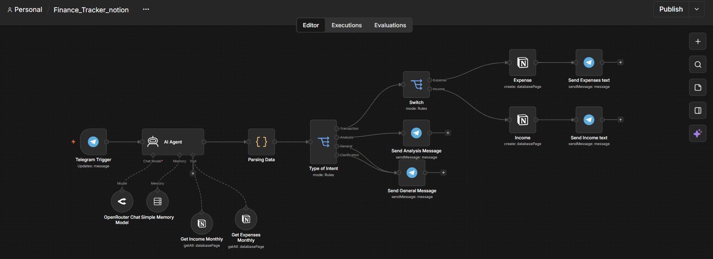

# 💰 AI-Powered Personal Finance Assistant

An AI-powered personal finance assistant built with **n8n, Telegram, OpenRouter, and Notion**. It helps users record income and expenses, retrieve stored financial records, and ask questions about their finances through natural-language messages.

Users can interact with the Telegram bot in **Egyptian Arabic, Modern Standard Arabic, or English** instead of manually entering every transaction or calculating totals.

---

## 📌 Project Overview

This project demonstrates how AI agents and workflow automation can be combined to build a conversational personal finance assistant.

The workflow receives a Telegram message, identifies what the user wants to do, extracts and validates the relevant information, and then routes the request to the appropriate process.

The assistant supports four message intents:

| Intent | Purpose |
| --- | --- |
| `Transaction` | Record a new income or expense. |
| `Analysis` | Retrieve and analyze stored financial records. |
| `General` | Handle general questions or continue a conversation. |
| `Clarification` | Ask for missing or ambiguous transaction details. |

### Main capabilities

- Record income and expenses through natural-language messages.
- Extract transaction amounts and dates.
- Classify transaction types and categorize expenses.
- Identify payment methods.
- Store transactions in separate Notion databases.
- Retrieve financial records to answer analysis questions.
- Maintain short conversational context for follow-up messages.
- Validate AI-generated structured data before transaction routing.

---

## 📸 Workflow Preview


**High-level flow:**

`Telegram → AI Agent → Data Validation → Intent Routing → Notion / Telegram Response`

---

## ✨ Key Features

### 1. Natural-Language Transaction Tracking

Send a message to the Telegram bot to record an expense or income. The AI Agent extracts the transaction details from the message.

Supported languages:

- Egyptian Arabic
- Modern Standard Arabic
- English

### 2. Automated Categorization

The AI Agent uses predefined categories to classify transactions.

| Category | Description |
| --- | --- |
| `Essential` | Necessary expenses such as food, transportation, rent, and bills. |
| `Luxury` | Non-essential spending such as entertainment and personal shopping. |
| `Savings` | Money intentionally set aside as savings. |
| `Investment` | Investments such as gold, stocks, real estate, and professional courses. |
| `Income` | Money received by the user. |
| `Unknown` | Used when the transaction purpose cannot be determined. |

### 3. Financial Analysis

The assistant can use the connected Notion tools to retrieve stored income and expense records and answer questions about:

- Total income and expenses.
- Daily, weekly, monthly, and yearly spending.
- Salary and bonus history.
- Spending by category.
- Payment-method breakdown.
- Financial-period comparisons.
- Net cash flow and savings.

The intended calculations include:

- **Total Expenses** = Sum of recorded expenses.
- **Total Income** = Sum of recorded income.
- **Net Cash Flow** = Total Income − Total Expenses.

Historical financial analysis is based on records retrieved from Notion, not on conversational memory.

### 4. Intent Detection and Routing

Each incoming message is classified into one of four intents: `Transaction`, `Analysis`, `General`, or `Clarification`.

The workflow uses Switch nodes to route the validated result to the correct branch.

---

## 🏗️ Workflow Architecture

This section explains the main nodes and the role each one plays in the workflow.

### 1. Telegram Trigger

Receives incoming messages from the Telegram bot and starts the workflow whenever a new message arrives.

### 2. AI Agent

Acts as the central decision-making component. It is responsible for:

- Understanding the user’s message.
- Detecting the message intent.
- Extracting transaction details.
- Classifying income and expenses.
- Requesting financial records when analysis is needed.
- Preparing a structured response for the next workflow steps.

### 3. OpenRouter Chat Model

Connects the AI Agent to a language model through OpenRouter.

- Configured model identifier: `openrouter/free`.

### 4. Simple Memory

Maintains conversational context for each Telegram user.

- Uses the Telegram user ID as the session key.
- Keeps a context window of 10 messages.
- Helps the assistant understand follow-up messages.

**Important:** Memory is used for conversational context. It is not the source of historical financial records.

### 5. Get Expenses Monthly

A Notion tool connected to the AI Agent. It retrieves expense records from the `Expenses (Monthly)` database, including:

- Amount
- Transaction Date
- Category
- Payment Method
- Description

The assistant can use these records when answering expense-analysis questions.

### 6. Get Income Monthly

A Notion tool connected to the AI Agent. It retrieves income records from the `Income (Monthly)` database, including:

- Amount
- Transaction Date
- Income Description

The assistant can use these records for income totals, salary history, bonuses, and income comparisons.

### 7. Parsing Data (Code Node)

Acts as a validation layer between the AI Agent and the workflow’s routing logic.

It:

- Parses the AI Agent’s JSON output.
- Checks that required fields exist.
- Validates supported intent values.
- Validates transaction types, categories, and payment methods.
- Ensures transaction amounts are positive numbers.
- Validates transaction date formats and dates.
- Stops execution when invalid or incomplete structured output is detected.

This reduces the risk of malformed AI output reaching the transaction-processing branches.

### 8. Type of Intent (Switch Node)

Routes the validated result according to the detected intent:

- **Transaction:** Sends the request to transaction processing.
- **Analysis:** Sends the analysis response through the analysis response path.
- **General:** Sends a general response to Telegram.
- **Clarification:** Sends a clarification response to Telegram.

### 9. Switch (Transaction Type)

Handles the second routing stage for transaction requests. It checks the `Transaction Type` field and separates the request into:

- **Expense:** Routes the transaction to the Expenses Notion database.
- **Income:** Routes the transaction to the Income Notion database.

### 10. Notion Transaction Storage

The workflow uses two separate Notion databases.

**Expenses (Monthly)**

| Property | Purpose |
| --- | --- |
| Amount | Expense amount |
| Transaction Date | Date of the transaction |
| Category | Expense category |
| Description | Expense details |
| Payment Method | Method used to pay |

**Income (Monthly)**

| Property | Purpose |
| --- | --- |
| Amount | Income amount |
| Transaction Date | Date the income was received |
| Income Item | Description or source of income |

Each transaction is stored in the corresponding database based on its type.

### 11. Telegram Response Nodes

Send the appropriate message after the request has been processed. The workflow includes response paths for:

- Expense confirmation.
- Income confirmation.
- Financial analysis.
- General responses.
- Clarification requests.

---

## 🔄 How the Workflow Works

1. The user sends a message through Telegram.
2. Telegram Trigger receives the incoming message and starts the workflow.
3. The AI Agent interprets the message using the OpenRouter chat model.
4. Simple Memory provides conversational context when needed.
5. If financial analysis is requested, the AI Agent can retrieve records through the connected Notion tools.
6. The AI Agent returns structured JSON.
7. Parsing Data checks and validates the generated output.
8. Type of Intent routes the request to the appropriate branch.
9. If the request is a transaction, Switch (Transaction Type) determines whether it is an expense or income.
10. The corresponding Notion database stores the transaction.
11. Telegram sends the appropriate response to the user.

---

## 💬 Practical Examples

### Example 1: Recording an Expense

**User sends:**

```
صرفت 250 جنيه مواصلات النهارده عن طريق InstaPay
```

**Example of the extracted information:**

| Field | Extracted Value |
| --- | --- |
| Intent | `Transaction` |
| Amount | `250` |
| Transaction Type | `Expenses` |
| Category | `Essential` |
| Date | Telegram message date (Africa/Cairo timezone) |
| Payment Method | `Instapay` |

**What happens:**

1. Telegram Trigger receives the message.
2. The AI Agent identifies it as an expense transaction.
3. The AI Agent extracts the amount, date, category, and payment method.
4. Parsing Data validates the structured output.
5. Type of Intent routes it to the Transaction branch.
6. Switch (Transaction Type) identifies it as an expense.
7. The expense record is created in the `Expenses (Monthly)` Notion database.
8. Telegram sends a confirmation message.

**Example Telegram confirmation:**

```
تم الخصم بنجاح
```

### Example 2: Asking for Financial Analysis

**User sends:**

```
صرفت كام الشهر ده؟
```

**What happens:**

1. The AI Agent identifies the intent as `Analysis`.
2. It understands that the user is asking about monthly expenses.
3. It calls `Get Expenses Monthly` to retrieve expense records.
4. It analyzes the retrieved records using their transaction dates.
5. Parsing Data validates the generated response.
6. Type of Intent routes the result to the Analysis branch.
7. Telegram sends the analysis response.

**Illustrative response:**

```
إجمالي مصروفاتك الشهر ده: 8,500 جنيه.

أكبر فئة إنفاق عندك هي Essential.
```

> The figures above are examples only. Actual results depend on the records stored in the connected Notion database.
> 

---

## 🧰 Technologies & Tools

| Technology | Purpose |
| --- | --- |
| n8n | Workflow automation and orchestration |
| Telegram Bot API | User interaction and messaging |
| OpenRouter | AI model integration |
| AI Agent | Natural-language understanding and decision-making |
| Notion | Financial data storage and retrieval |
| JavaScript | Parsing and validation logic in the Code node |
| Simple Memory | Conversational context management |

---

## 🗂️ Notion Template & Database Setup

The Notion workspace used as the starting point for this project is the **Budget Planning** template from the Notion Template Gallery.

**Template link:** Notion – Budget Planning

The n8n workflow expects two separate databases with specific properties. The template should therefore be checked and adapted in your own Notion workspace before connecting it to n8n.

### Required database structure

**Expenses (Monthly)**

- `Amount`
- `Transaction Date`
- `Category`
- `Description`
- `Payment Method`

**Income (Monthly)**

- `Amount`
- `Transaction Date`
- `Income Item`

Make sure the property names and property types in Notion match the fields expected by the workflow’s Notion nodes. If the template uses different names or a different structure, adjust the databases or the Notion node configuration accordingly.

> The linked Budget Planning template is the starting point used for this project. It is not presented as a separate, custom-built or preconfigured template that is guaranteed to work with the workflow without setup.
> 

---

## ⚙️ Setup & Configuration

To run this workflow in your own n8n instance:

1. Download `Finance_Tracker_notoin.json` from this repository.
2. Open your n8n instance.
3. Import the downloaded workflow JSON file.
4. Create and configure your own Telegram Bot credentials.
5. Configure your OpenRouter API credentials.
6. Connect your Notion integration.
7. Prepare the required Notion databases and properties described above.
8. Select and configure the appropriate Notion databases in the workflow’s Notion nodes.
9. Test the workflow with sample Telegram messages.
10. Activate the workflow after confirming that the integrations and database mappings work correctly.

### Credentials and configuration

The exported workflow does **not** provide working credentials for your personal accounts or configure your Notion databases for you.

You must connect your own Telegram, OpenRouter, and Notion accounts and select the correct databases before the workflow can run successfully.

---

## 🔐 Data Accuracy & Reliability

The workflow includes safeguards intended to improve the reliability of transaction processing:

- Validates AI-generated structured data before routing.
- Requires positive numeric amounts for transactions.
- Validates transaction dates.
- Uses predefined transaction categories and payment methods.
- Retrieves actual Notion records for historical financial analysis.
- Does not treat conversational memory as historical financial data.
- Requests clarification when essential transaction information is missing or ambiguous.
- Separates financial-analysis requests from transaction creation.

---

## 📁 Project Files

| File | Description |
| --- | --- |
| `Finance_Tracker_notoin.json` | Exported n8n workflow |
| `workflow.png` | Workflow architecture screenshot |
| `README.md` | Project documentation |

---

**Built with n8n, OpenRouter, Telegram, and Notion.**
